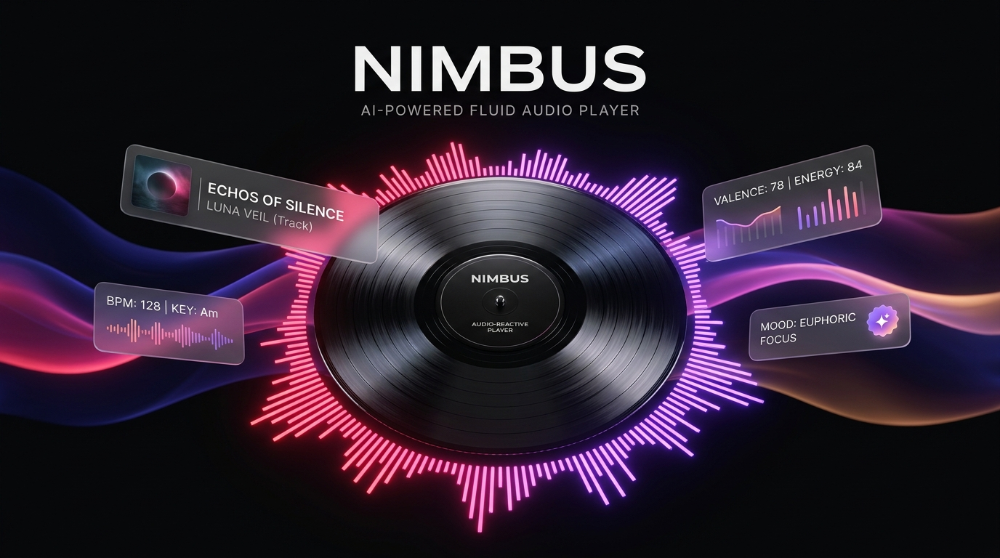

# 🎵 Nimbus — Minimalist Audio Player & Recommender



> Production-quality, motion-rich music player web app inspired by **daydreamplayer.com**, powered by a **FastAPI** backend, **scikit-learn Cosine Nearest Neighbors** on 157,685 tracks, and a **Vite + React + Three.js** frontend with a 120Hz audio-reactive WebGL fluid shader.

---

## 🌐 Permanent Live Link (24/7 Lifetime Cloud Deployment)

Nimbus is hosted in the cloud and accessible 24/7 on any phone, tablet, laptop, or desktop in the world:

👉 **[https://soundwave-app-production.up.railway.app](https://soundwave-app-production.up.railway.app)**

*No local server or computer needs to be kept on — this cloud URL is permanently live with automatic CI/CD deployment on every GitHub push.*

---

### Local Development & Wi-Fi Access
- **Local Laptop / PC**: `http://localhost:3000`
- **Mobile on Same Wi-Fi (LAN)**: `http://192.168.1.125:3000`
- **Optional Temporary Live Tunnel**: `python run_live.py` (or double-click `run_live.bat`)

---

## 🌟 Key Features

1. **Orchestrated Wordmark Loader & Audio Unlock**
   - Letter-by-letter reveal for `N I M B U S`.
   - "Press to listen" interaction that unlocks the Web Audio Context.

2. **Kinetic Typography & Variable Weight Morph**
   - Bricolage Grotesque variable optical font.
   - Smooth `font-variation-settings` morph toggle (`REGULAR / BOLD`).
   - Kinetic letter-by-letter animated song title on track changes.

3. **120Hz Audio-Reactive Fluid Aurora Shader**
   - Full-screen Three.js WebGL shader reacting to:
     - **Valence**: Shifts color palette from moody deep indigo/cyan to warm amber/crimson.
     - **Energy**: Controls wave flow velocity and turbulence.
     - **Bass**: Dynamic ripple pulse and scale displacement in real time via Web Audio `AnalyserNode`.
   - Delta-time exponential damping ($1 - e^{-\lambda \Delta t}$) with zero per-frame allocations.

4. **Radial Visualizer & Inertia Vinyl Disc**
   - 64 radial frequency bars circling the album artwork.
   - Vinyl rotational physics with smooth acceleration and deceleration damping.
   - Fallback Web Audio ambient synthesizer when an iTunes preview is unavailable.

5. **Cosine KNN Machine Learning Engine**
   - 157,685 unique tracks from the Spotify dataset, deduplicated on `(name, artists)` and indexed by Spotify ID.
   - `StandardScaler` normalization over 9 acoustic features (`valence`, `energy`, `danceability`, `loudness`, `tempo`, `acousticness`, `instrumentalness`, `liveness`, `speechiness`).
   - Dynamic $k$-nearest neighbors query with exact cosine similarity match percentages.

6. **Curated Gallery & Instant Search**
   - Filter tracks by mood quadrants (Euphoric, Chill, Melancholic, Intense) and decade (1960s – 2020s).
   - Instant search modal (`⌘K` or `/`) with real-time popularity ranking.
   - Media Session API support (OS lock screen controls, metadata, and artwork).

7. **Stage, Right AI Match + Up Next Drawer & Vibe Mixer**
   - Floating frosted-glass navbar (`Stage | Vibe Mixer | Library`) over the living aurora shader.
   - Unified slide-over drawer showing KNN **AI Match** score breakdowns (`Energy`, `Valence`, `Tempo`) and a reorderable **Up Next** queue with Shuffle, Repeat, and Auto-Play Radio.
   - **Vibe Mixer** (`POST /api/mix`) with acoustic sliders and one-click presets (*Late Night Focus*, *High-Energy Workout*, *Chill Acoustic*, *Euphoric*).

8. **5-Band EQ, Crossfade, Glowing Synced Lyrics & Local Audio**
   - 5-band Web Audio `BiquadFilterNode` equalizer (`60Hz`, `230Hz`, `910Hz`, `3.6kHz`, `14kHz`) with vertical faders, presets, and `2s`/`4s`/`6s` crossfade.
   - Full-screen **Glowing Synced Lyrics** powered by LRCLIB with click/tap-to-seek and auto-scroll.
   - Local **Library** (`Liked`, `Playlists`, `Recently Played`, `Local Files` MP3/WAV/FLAC/M4A via IndexedDB, JSON export/import) + **Your Aura** listening stats + Sleep Timer.

9. **Installable Everywhere (PWA, Windows `.exe`, Android `.apk`)**
   - Full PWA manifest and Workbox service worker for iOS, Android, Windows, and macOS installation.
   - Native Windows `.exe` wrapper powered by `pywebview` and PyInstaller (`dist/Nimbus/Nimbus.exe`).
   - Native Android wrapper powered by Capacitor (`com.nimbus.musicplayer`) pointing cleanly at a configurable `VITE_API_BASE_URL` backend.

---

## 🚀 How to Run

### 1. Run Locally (Full-Stack Web + PWA Server)
```bash
# Install backend dependencies
pip install -r backend/requirements.txt

# Build frontend (only needed once or after frontend edits)
cd frontend && npm install && npm run build && cd ..

# Start unified FastAPI + Vite server
python start.py
```
Available at `http://localhost:3000` (PC) and `http://<YOUR_LOCAL_IP>:3000` (Mobile on same Wi-Fi).

### 2. Install as a Mobile or Desktop PWA
Browsers require **HTTPS** (or `localhost`) to install a Progressive Web App. Deploy to any container host (Railway, Render, or Fly.io) using the included [Dockerfile](Dockerfile) — or open the live HTTPS link above:
- **Android (Chrome / Edge)**: Open the HTTPS URL → tap the browser menu (`⋮`) → **Install app** / **Add to Home screen**.
- **iOS (Safari)**: Open the HTTPS URL → tap **Share** (`□↑`) → **Add to Home Screen**.
- **Windows / macOS (Chrome / Edge)**: Open the URL → click the **Install** icon in the address bar.

### 3. Build Standalone Windows Desktop App (`.exe`)
Package Nimbus into a self-contained Windows application (`dist/Nimbus/Nimbus.exe`) powered by `pywebview` and `PyInstaller`:
```bash
pip install -r requirements-desktop.txt
python build_windows.py
```
Then launch `dist/Nimbus/Nimbus.exe` directly — no separate terminal or browser required.

### 4. Build Native Android App (`.apk` via Capacitor)
Point the Android build at your deployed HTTPS Nimbus backend (see `frontend/.env.example`):
```bash
# In frontend/.env
VITE_API_BASE_URL=https://your-nimbus-backend.onrender.com
```
Then build, sync the Capacitor Android project, and package the APK:
```bash
cd frontend
npm run android:sync
```
- **Android Studio**: run `npm run android:open` and click **Build → Build Bundle(s) / APK(s) → Build APK(s)**.
- **Command Line**:
  ```bash
  cd frontend/android
  ./gradlew assembleDebug    # Windows: gradlew.bat assembleDebug
  ```
Install the generated APK from `frontend/android/app/build/outputs/apk/debug/app-debug.apk` on your Android device.

### 5. Development Mode (Hot Reload)
```bash
# Terminal 1 - FastAPI Backend
python -m uvicorn backend.main:app --host 0.0.0.0 --port 8000 --reload

# Terminal 2 - Vite React Frontend
cd frontend
npm run dev
```

### 6. Optional Live Quick Tunnel
```bash
python run_live.py
```

---

## 🧪 Testing

Run the automated backend test suite:
```bash
python -m pytest backend/tests/test_api.py -v
```
All 8 tests verify:
- Health check
- Search ranking & case-insensitivity
- Dynamic recommendation with $k=10$ + feature deltas & match reasons
- Duplicate song title handling by Spotify ID
- Gallery mood and decade filtering
- Audio stream proxy allowlist & CORS Range headers
- Vibe/Mood Mixer (`POST /api/mix`)
- Capacitor & mobile origin CORS (`https://localhost`, `http://localhost`, `capacitor://localhost`)

---

## 🛠️ API Reference

| Endpoint | Description |
|---|---|
| `GET /api/search?q=&limit=8` | Fast case-insensitive search ranked by popularity |
| `GET /api/track/{id}` | Metadata and audio features (valence, energy, tempo, key, etc.) |
| `GET /api/recommend/{id}?k=8` | Cosine KNN similarity recommendations with match scores |
| `GET /api/gallery?mood=&decade=&limit=60` | Curated gallery filterable by mood and decade |
| `POST /api/mix` | Vibe/Mood Mixer matching target acoustic features (`valence`, `energy`, `danceability`, `acousticness`, `tempo`) |
| `GET /api/artworks?ids=` | Batch album artwork lookup with Spotify oEmbed & iTunes fallback |
| `GET /api/preview/{id}` | 600x600 artwork and 30s preview clip lookup |
| `GET /api/stream?url=` | Audio stream proxy with HTTP 206 Range & CORS headers |
